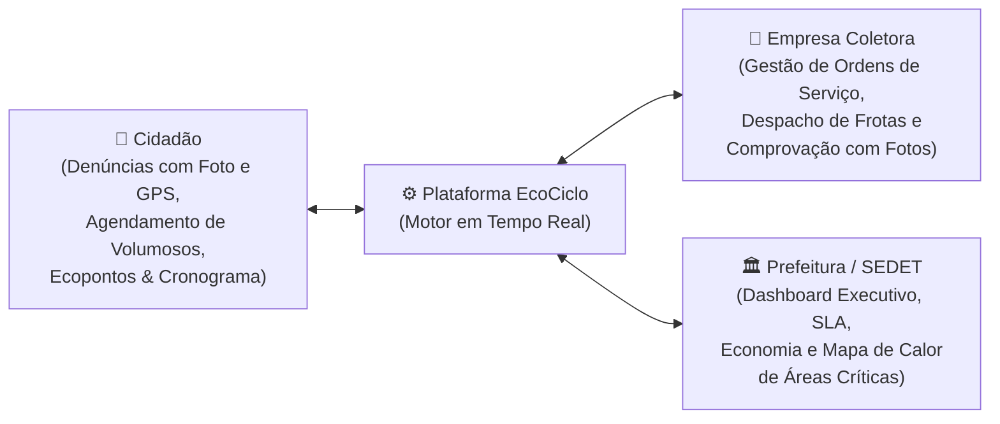

# ♻️ EcoCiclo — Plataforma Web Integrada de Gestão de Resíduos Sólidos

> **Instituto Federal de Educação, Ciência e Tecnologia de Alagoas (IFAL)**  
> **Projeto Interdisciplinar — Etapas 3 e 4 (Engenharia de Software, Modelagem e Testes)**  
> *Transformando o descarte irregular em gestão inteligente, sustentabilidade e transparência.*

---

## 👥 Equipe de Desenvolvimento e Divisão de Papéis

| Integrante | Papel Principal | Atribuições Principais |
| :--- | :--- | :--- |
| **Adriely Rauane Soares da Silva** | Scrum Master / Gerente de Configuração | Gestão do fluxo ágil, Kanban, branches Git e acompanhamento do backlog |
| **Ana Luiza Barbosa da Silva Mariano** | Desenvolvedora Frontend & UI/UX | Design de interfaces, prototipação responsiva e integração de componentes |
| **Francyne Gabrielle Sotero da Silva** | Desenvolvedora Backend & Banco de Dados | Modelagem relacional ER, script SQL (`schema.sql`) e lógica de APIs |
| **Maria Júlia Tenória Vieira** | Analista de Qualidade de Software (QA) | Critérios de aceitação, casos de testes, inspeção de PRs e validação |
| **Rayssa da Silva Alves** | Administradora de Serviços Web (DevOps) | Configuração de deploy, documentação técnica (`README.md`) e versionamento |

---

## 🎯 A Solução: Os Três Atores Conectados em Tempo Real

O **EcoCiclo** fecha o ciclo da limpeza urbana conectando em tempo real os três agentes fundamentais:



### 1. 👤 O Cidadão (Morador Ativo)
* **Canal de Denúncia com Foto e GPS:** Captura automática de coordenadas geográficas via satélite (`navigator.geolocation`), upload de fotografia da irregularidade, classificação de severidade (foco de dengue ou obstrução pública) e emissão de protocolo rastreável (ex: `#DEN-2026-8941`).
* **Agendamento de Coleta de Resíduos Volumosos (Cata-Treco):** Agendamento gratuito para retirada de sofás, móveis velhos, eletrodomésticos da linha branca, restos de poda e entulhos de reformas residenciais.
* **Mapa Interativo de Ecopontos (Leaflet.js & OpenStreetMap):** Localização dos Postos de Entrega Voluntária (PEV) de Maceió/AL, com filtros dinâmicos por tipo de material aceito, horário de funcionamento e traçado de rotas.
* **Cronograma de Coleta por Bairro:** Consulta rápida de dias e turnos da coleta domiciliar convencional, coleta seletiva porta a porta e rotas semanais do caminhão Cata-Treco.
* **Linha do Tempo & Rastreamento com Comprovante:** Acompanhamento passo a passo da demanda (Registrada ➔ Triagem ➔ Em Rota ➔ Concluída) com acesso ao **Laudo Fotográfico (Foto Antes e Foto Depois)** emitido pela empresa coletora.
* **Calculadora de Impacto Ambiental:** Medição da água poupada, CO₂ evitado e kWh economizados.

### 2. 🚛 A Empresa de Coleta (Operação em Campo)
* **Gestão e Otimização de Ordens de Serviço (O.S.):** Triagem inteligente, priorização automática para focos com risco epidemiológico ou viário e atribuição de equipes/veículos.
* **Despacho de Frotas:** Roteirização de caminhões compactadores, caçambas e veículos Cata-Treco.
* **Comprovação de Atendimento com Laudo Fotográfico:** Registro obrigatório da **Foto do Antes** e da **Foto do Depois (Local Limpo)**, pesagem real coletada (kg), destinação ambientalmente adequada (CTR Maceió / Cooperativas) e assinatura digital do encarregado.

### 3. 🏛️ A Prefeitura / Gestão Pública (Dashboard e Governança)
* **Indicadores Executivos em Tempo Real (KPIs):**
  * **SLA / Tempo Médio de Resolução:** Redução expressiva de 72h para 14.8h.
  * **Taxa de Resolução de Ocorrências:** 94.6% de sucesso com comprovação fotográfica.
  * **Volume Desviado de Aterros Clandestinos:** Toneladas recolhidas e encaminhadas a cooperativas de reciclagem.
  * **Economia aos Cofres Públicos:** R$ 412.000 poupados em desassoreamento de canais e saúde pública preventiva.
* **Mapa de Calor e Monitoramento de Áreas Críticas (Hotspots):** Identificação algorítmica de bairros com alta reincidência de lixões clandestinos (ex: Jacintinho, Benedito Bentes, Levada) para instalação preventiva de novos Ecopontos.
* **Gráficos Interativos (Chart.js):** Evolução mensal de denúncias vs. resoluções e distribuição por categorias de resíduo.
* **Governança Territorial:** Cadastro e controle de capacidade dos Ecopontos municipais (RF07).

---

## 💻 Tecnologias Utilizadas

| Camada | Ferramenta / Biblioteca | Descrição |
| :--- | :--- | :--- |
| **Interface / Frontend** | HTML5, Tailwind CSS, Plus Jakarta Sans | Interface limpa, moderna, responsiva e acessível |
| **Mapeamento Geo** | Leaflet.js, OpenStreetMap | Mapa interativo com geolocalização e marcadores customizados |
| **Visualização de Dados** | Chart.js | Gráficos dinâmicos para o dashboard executivo |
| **Ícones & Estilo** | FontAwesome 6, Micro-interações | Ícones semânticos para acessibilidade e clareza visual |
| **Banco de Dados** | MySQL (`schema.sql`) | Modelagem relacional completa normalizada |
| **Persistência Reativa** | LocalStorage Engine | Sincronização em tempo real entre as visões dos três atores |

---

## 🗄️ Estrutura de Pastas do Repositório

```text
ecociclo/
│
├── index.html              # Aplicação Web SPA completa (3 Atores + Mapa + Dashboard)
├── schema.sql              # Script DDL/DML de migração e estrutura do banco MySQL
├── README.md               # Documentação técnica e guia do projeto acadêmico
└── .gitignore              # Configuração de arquivos ignorados pelo Git
```

---

## 🚀 Como Executar o Projeto Localmente

1. Clone o repositório ou baixe os arquivos da pasta do projeto:
   ```bash
   git clone https://github.com/ecociclo/ecociclo.git
   cd ecociclo
   ```
2. Abra o arquivo `index.html` diretamente em qualquer navegador moderno (Chrome, Edge, Firefox, Safari ou Opera).
3. Não é necessária a instalação de dependências pesadas, pois os recursos utilizam CDNs otimizados e seguros.
4. Para simular o banco de dados em um servidor local MySQL:
   * Importe o arquivo `schema.sql` via phpMyAdmin, MySQL Workbench ou terminal:
     ```bash
     mysql -u seu_usuario -p < schema.sql
     ```

---

## 🌐 Publicação na Internet

A plataforma está publicada e disponível publicamente na nuvem para demonstração e avaliação:
* **URL de Acesso Público:** [https://natural-iridium-7drgi.ship.place/](https://natural-iridium-7drgi.ship.place/)
* **Painel de Gestão da URL:** [https://ship.page/claim?slug=natural-iridium-7drgi&token=spc_lv1psn87k9i532j7w3abf9un&via=api](https://ship.page/claim?slug=natural-iridium-7drgi&token=spc_lv1psn87k9i532j7w3abf9un&via=api) (Permite fixar a página e gerenciar por 30+ dias)

---

*Projeto desenvolvido com rigor técnico e compromisso socioambiental para o Instituto Federal de Alagoas.*
